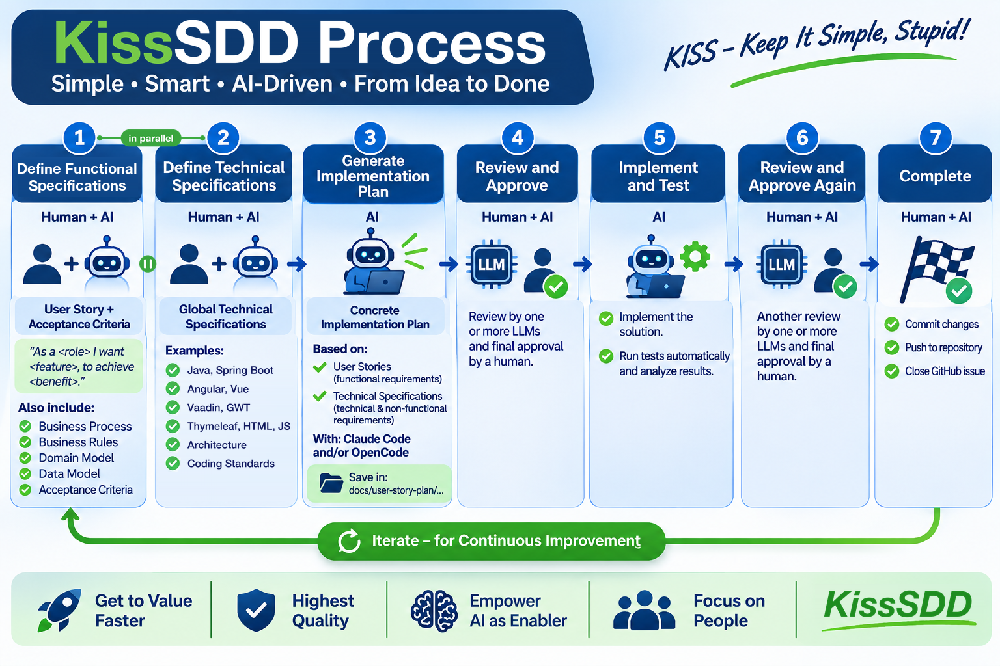

# KissSDD

**🌐 Website: [lofidewanto.github.io/KissSDD](https://lofidewanto.github.io/KissSDD/)**

🇬🇧 [English](https://lofidewanto.github.io/KissSDD/?lang=en) · 🇩🇪 [Deutsch](https://lofidewanto.github.io/KissSDD/?lang=de)

**Spec-Driven Development (SDD) with AI, the simple way. Keep It Simple, Stupid!**

This repository holds the homepage for **KissSDD**, a simple approach to Specification-Driven Development with AI coding agents such as Claude Code or OpenCode. It is a static website, published with GitHub Pages. There is no application code and no build step.



## The idea

There are many SDD frameworks (AI Unified Process, GitHub Spec Kit, OpenSpec, BMAD, Get Shit Done …). If you are new to SDD, don't start with one of them. Start simple:

1. **Define Functional Specifications** (Human + AI): a User Story with acceptance criteria in a GitHub Issue.
2. **Define Technical Specifications** (Human + AI): global specs such as the stack (e.g. Java, Spring Boot, Angular, Vue, Vaadin, GWT, DominoUI, WebFX, Thymeleaf, HTML, JS), architecture and coding standards. *Can be done in parallel with step 1.*
3. **Generate Implementation Plan** (AI): saved in `docs/user-story-plan/…`.
4. **Review and Approve** (Human + AI): one or more LLMs review, a human approves.
5. **Implement and Test** (AI)
6. **Review and Approve Again** (Human + AI)
7. **Complete** (Human + AI): commit, push, close the GitHub Issue.

Then iterate for continuous improvement. The full explanation, model recommendations per step, and next steps are on the [website](https://lofidewanto.github.io/KissSDD/), in English and German.

## Step-by-step example

**👉 [Create a simple web app for managing prompts](https://lofidewanto.github.io/KissSDD/example/)**: one feature taken through all seven steps, one page per step. It shows the User Story, the technical spec, the plan, both reviews with human decisions, real test runs and the commit. The result is a [working Prompt Manager](https://lofidewanto.github.io/KissSDD/example/app/) in plain HTML/JS with 16 unit tests (`cd docs/example/app && npm test`). The example is in English.

## Repository contents

The whole website lives in `docs/`:

| Path | What it is |
|---|---|
| `docs/index.html` | The whole website: one self-contained page, English/German switch (`?lang=en` / `?lang=de`), light/dark mode |
| `docs/example/` | Step-by-step example: `index.html`, one page per step (`step-1-…html` to `step-7-…html`), shared `example.css` |
| `docs/example/app/` | The Prompt Manager built in the example, with its unit tests |
| `docs/img/sdd-kiss-en.png`, `docs/img/sdd-kiss-de.png` | Process infographics (English / German) |
| `docs/img/og-en.jpg` | 1200×630 link preview image for LinkedIn, WhatsApp etc. |
| `docs/img/icons/`, `docs/favicon.ico`, `docs/site.webmanifest` | Browser and home-screen icons |
| `docs/.nojekyll` | Tells GitHub Pages to serve the files as they are |

## Run locally

Open `docs/index.html` in a browser, or serve the folder:

```sh
python3 -m http.server 8000 --directory docs
# → http://localhost:8000
```

## Deployment

GitHub Pages serves the `docs/` folder of the `main` branch. Every push to `main` updates the website.

## Author

[Dr. Lofi Dewanto](https://de.linkedin.com/in/dr-lofi-dewanto). Original idea: [LinkedIn post](https://lnkd.in/p/exjrYTQB).
